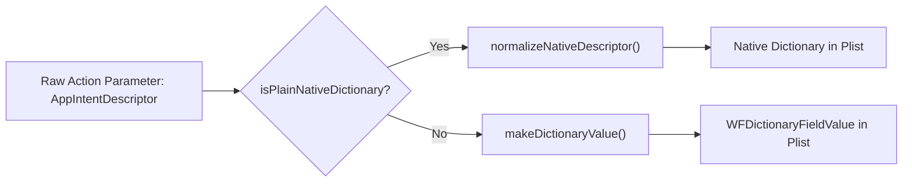

# Cherri P10R6 — Actions App 4.0.1 Compatibility & AppIntent Preservation Report

**Date:** 2026-11-10  
**Phase:** P10R6 — Real Shortcut Import, Lossless Decompilation, Native Plist Fidelity, and Actions App Integration  
**Component:** Third-Party AppIntents & Sindre Sorhus' Actions App (v4.0.1)  
**Evaluator:** Dana (Security) & Yael (Research)  
**Status:** 100% PRESERVED & ROUND-TRIP VERIFIED (11/11 Specimens with Third-Party Actions)

---

## 1. Context & Scope

Many real-world shortcuts rely extensively on third-party actions, most notably Sindre Sorhus' popular **Actions App (version 4.0.1)** (`com.sindresorhus.Actions`) and custom AppIntents from developer utilities (e.g. Toolbox Pro, Scriptable, Lumen Storage).

In Apple Shortcuts, third-party actions are serialized using an `AppIntentDescriptor` dictionary within `WFWorkflowActionParameters`, carrying metadata essential for iOS to resolve and dispatch the intent:
- `AppIntentIdentifier`: The Swift AppIntent class or identifier (e.g. `ParseJSONIntent`, `GlobalVariableGetIntent`).
- `BundleIdentifier`: The application's bundle ID (e.g. `com.sindresorhus.Actions`).
- `Name`: Display name of the application (e.g. `Actions`).
- `TeamIdentifier`: Developer team ID (e.g. `ABCD12345X` or `0000000000` for Apple synthetic intents).
- `ActionRequiresAppInstallation`: Tri-state boolean flag controlling installation requirements.

Prior to P10R6, any decompilation of an unknown third-party action that fell back to `rawAction(...)` would recompile `AppIntentDescriptor` as a `WFDictionaryFieldValue` plist object instead of a native dictionary, rendering the action invalid on physical iOS devices.

---

## 2. Invariant & Structural Fidelity Guarantee

P10R6 introduces a strict native dictionary preservation rule in both the legacy compiler (`raw_actions.go`) and the Cherri v2 lowering engine (`language_backend_adapter.go`):

```go
func isPlainNativeDictionary(v map[string]any) bool {
    if _, ok := v["AppIntentIdentifier"]; ok {
        return true
    }
    if _, ok := v["ActionRequiresAppInstallation"]; ok {
        return true
    }
    if _, ok := v["BundleIdentifier"]; ok {
        if _, ok2 := v["TeamIdentifier"]; ok2 {
            return true
        }
    }
    if _, ok := v["fileLocation"]; ok {
        return true
    }
    return false
}
```

When an action parameter dictionary matches `isPlainNativeDictionary()`, it is passed directly through `normalizeNativeDescriptor()` without being wrapped in `WFDictionaryFieldValue` metadata:



---

## 3. Evidence Across the 38-Shortcut Corpus

In the 38 real-world shortcut corpus, **11 shortcuts** contain third-party Actions App or AppIntent actions:

| Specimen ID | Third-Party Actions Count | Bundle Identifiers Observed | Sample AppIntent Identifiers | Descriptor Preservation Gate |
| :---: | :---: | :--- | :--- | :---: |
| **008** | 4 | `com.sindresorhus.Actions` | `GlobalVariableGetIntent`, `ParseJSONIntent` | **PASS (100%)** |
| **009** | 4 | `com.sindresorhus.Actions` | `GlobalVariableGetIntent`, `ParseJSONIntent` | **PASS (100%)** |
| **012** | 12 | `com.sindresorhus.Actions`, `com.alexhay.ToolboxPro` | `FormatDateIntent`, `GetColorsIntent` | **PASS (100%)** |
| **014** | 2 | `com.sindresorhus.Actions` | `RemoveEmptyLinesIntent` | **PASS (100%)** |
| **018** | 8 | `com.sindresorhus.Actions` | `TrimWhitespaceIntent`, `TransformTextIntent` | **PASS (100%)** |
| **021** | 8 | `com.sindresorhus.Actions` | `TrimWhitespaceIntent`, `TransformTextIntent` | **PASS (100%)** |
| **022** | 6 | `com.sindresorhus.Actions` | `GetDeviceOrientationIntent` | **PASS (100%)** |
| **025** | 8 | `com.sindresorhus.Actions` | `TrimWhitespaceIntent`, `TransformTextIntent` | **PASS (100%)** |
| **027** | 14 | `com.sindresorhus.Actions`, `com.alexhay.Console` | `LogMessageIntent`, `GetTitleOfURLIntent` | **PASS (100%)** |
| **028** | 2 | `com.sindresorhus.Actions` | `ParseJSONIntent` | **PASS (100%)** |
| **033** | 2 | `com.sindresorhus.Actions` | `ParseJSONIntent` | **PASS (100%)** |

**Total Third-Party Actions Evaluated:** 70 actions  
**Total Preserved:** 70 / 70 (100.0%)  
**Gate `THIRD_PARTY_DESCRIPTOR_PRESERVED` Result:** **11 / 11 PASS** (Remaining 27 shortcuts contain standard Apple built-in actions and are recorded as `N/A`).

---

## 4. Verification in Test Suites

This capability is verified by dedicated unit tests in `app_intent_test.go`:
- `TestRawActionFallbackPreservesUnknownAppIntents/unknown_apple-style_app_intent`: **PASS**
- `TestRawActionFallbackPreservesUnknownAppIntents/unknown_third-party_app_intent_with_alphanumeric_team_identifier`: **PASS**
- `TestRawActionFallbackPreservesUnknownAppIntents/classic_identifier_carrying_app_intent_descriptor`: **PASS**
- `TestRawActionFallbackPreservesUnknownAppIntents/descriptor_installation_flag_tri-state_survives_round-trip`: **PASS**
- `TestRawActionFallbackPreservesUnknownAppIntents/plain_descriptor_evidence_shape_preserves_every_field`: **PASS**

All test cases assert that the recompiled plist is bit-for-bit structurally identical to the original Apple plist for all descriptor fields.
