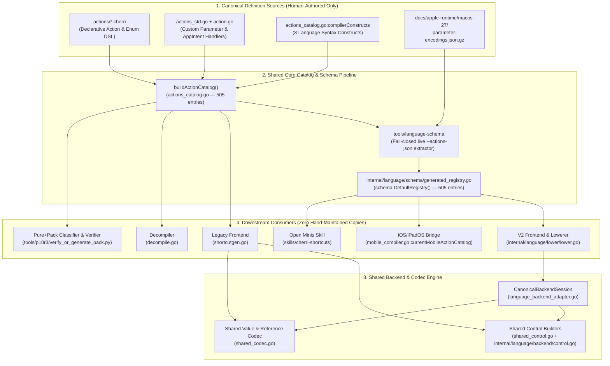

# Cherri P10 — Single Source of Truth Architecture (Before vs. After)

## 1. Executive Architecture Summary

This document records the consolidated Single Source of Truth (SSoT) architecture across the Cherri compiler (Legacy & V2), Decompiler, CLI Action Catalog (`--actions-json`), Generated Schema Registry (`internal/language/schema/generated_registry.go`), iOS/iPadOS Mobile Bridge (`CherriActionCatalog` / `currentMobileActionCatalog()`), Open Minis Skill, and Pure Original (`apple-actions-pack`).

### Before Consolidation (Audit Issues Identified)
1. **Schema Generator Drift & Silent Fallback:**
   - `tools/language-schema/main.go` silently fell back to `docs/language-v2/baseline-catalog.json` if `go run . --actions-json` failed.
   - `tools/language-schema/main.go` double-escaped strings (`escapeString(...)` inside `fmt.Fprintf(..., "%q")`), corrupting quotes in `InsertionSnippet` (`menu(\"Choose\")` became `menu(\\\"Choose\\\")`), `Description`, and `DefaultValue`.
   - `internal/language/schema/generated_registry.go` dropped `EmittedKeys`, `RawOutputType`, `RawType`, `Reference`, `Literal`, `Builtin`, `Custom`, and `RequiresAppInstallation`, and contained manual edits (`adjustDate`) and stale wire keys (`statistic` with `Input` instead of `WFInput`).
2. **CLI vs. iOS Mobile Bridge Catalog Divergence:**
   - `buildActionCatalog()` (`actions_catalog.go`) built its 505 entries from `actions` + `compilerConstructs`, while `currentMobileActionCatalog()` (`mobile_compiler.go`) projected a partial subset from `schema.DefaultRegistry()`, omitting `EmittedKeys`, `MacOnly`, `NonMacOnly`, `MinVersion`, `MaxVersion`, `Builtin`, `Custom`, `StaticParameters`, `Reference`, `Literal`, `Infinite`, and `RequiresAppInstallation`, and substituting `OutputTypeName` (`"Unknown"`) for empty `OutputType`.
3. **Ownership Ledger Status Lag:**
   - Six entries in `docs/architecture/action-emitter-ownership.json` remained labeled `"TARGET_CONSOLIDATION"` even after their underlying implementations had been unified onto `shared_control.go` (`internal/language/backend/control.go`) and `shared_codec.go`.
4. **Hardcoded Pack Generator Paths:**
   - `tools/p10r3/generate_catalog_and_pack_ledgers.py` filled `legacySupported`, `v2Supported`, `decompileSupported`, and `roundTripVerified` with hardcoded `True` values instead of executing the compiler/decompiler across all 505 entries.

---

### After Consolidation (Single Source of Truth Architecture)

---

## 2. Canonical Ownership Matrix by Subsystem

| Subsystem | Canonical Owner (Files / Symbols) | Legacy Path | V2 Path | Downstream Consumers | Status & Verification Gate |
| :--- | :--- | :--- | :--- | :--- | :--- |
| **Declarative Actions & Enums** | `actions/*.cherri` + `action.go:standardActions()` | `shortcutgen.go:makeAction` | `lower.go:lowerCall` -> `CanonicalBackendSession.EmitResolvedCall` | CLI `--actions-json`, `schema.DefaultRegistry()`, iOS Palette, Decompiler, Pure+Pack | `CANONICAL_OWNER` (`TestP10_CatalogCLIAndMobileRegistryParity`) |
| **Complex / Handler Actions** | `actions_std.go` + `action.go:checkAction / getActionParameters` | `shortcutgen.go:makeAction` -> `getActionParameters` | `language_backend_adapter.go:EmitResolvedCall` -> `getActionParameters` | Legacy compiler, V2 compiler, Decompiler | `CANONICAL_OWNER` (`TestP10_AutomaticActionPropagation_Scenarios1To4`) |
| **Machine-Readable Catalog** | `actions_catalog.go:buildActionCatalog()` | `--actions-json` | `tools/language-schema` -> `schema.DefaultRegistry()` | `mobile_compiler.go:currentMobileActionCatalog()`, `CherriActionCatalog` | `CANONICAL_OWNER` (`TestP10_CatalogCLIAndMobileRegistryParity`) |
| **Control Flow (`if` / `menu` / `repeat` / `for`)** | `internal/language/backend/control.go` + `shared_control.go` | `shortcutgen.go:makeConditionalAction / makeMenuAction / makeRepeatAction` | `lower.go:lowerIfWithOutput / lowerMenuWithOutput / lowerRepeatWithOutput` -> `BeginControl / EndControl` | Legacy & V2 Plist emitters | `SHARED_DELEGATED` (`CTRL-001..CTRL-006`, `TestP10_ActionEmitterOwnershipAndQuarantine`) |
| **Value & Reference Codec** | `shared_codec.go` (`EncodeReferenceValue`, `EncodeTextSegmentsShared`, `EncodeDictionaryItemShared`) | `shortcutgen.go:variableValueWithSerialization / makeAttachmentValues / makeDictionary` | `language_value_adapter.go` + `lower.go:lowerBinding` | Legacy & V2 Plist emitters | `CANONICAL_OWNER` (`CODE-001..CODE-010`, `TestArchitecture_D_SharedCodecMaintenance`) |
| **Workflow Header & Metadata** | `shared_control.go:BuildWorkflowHeader` + `language_backend_adapter.go:SetMetadata` | `shortcutgen.go:generateShortcut` | `language_backend_adapter.go:NewCanonicalBackendSession` | Legacy & V2 Plist emitters | `CANONICAL_OWNER` (`META-001..META-003`) |
| **Function Dispatch Envelope** | `internal/language/lower/lower.go:lowerProgramWithFunctions` | `functions.go` (legacy preprocessor injection) | `lower.go:lowerProgramWithFunctions` | V2 typed functions with recursion & named/default args | `ACTIVE` (`FUNC-001..FUNC-004`) |
| **Lossless Escape (`rawAction` / `native.action`)** | `raw_actions.go:makeRawAction` + `language_backend_adapter.go:EmitRawAction` | `raw_actions.go:makeRawAction` | `lower.go:lowerCall` -> `EmitRawAction` | Decompiler fallback, custom 3rd-party intents | `ACTIVE` (`TestArchitecture_C_NativeActionBypassesTypedAction`) |
| **Quarantined Prototype Emitter** | `language_emit_adapter.go:EmitNativeWorkflow` | None | Quarantined (never called by `CompileSourceToPlist`) | Isolation test only (`language_emit_adapter_test.go`) | `QUARANTINED` (`TestP10_ActionEmitterOwnershipAndQuarantine`) |

---

## 3. End-to-End Automatic Action Propagation Contract

Adding or modifying an action in `actions/*.cherri` (and `actions_std.go` when custom plist construction is required) propagates through the entire platform in two deterministic steps:
1. Edit canonical source in `actions/*.cherri` (and optional handler in `actions_std.go`).
2. Run `go run ./tools/language-schema` (enforced in CI via `go run ./tools/language-schema --verify-generated`).

All downstream surfaces update automatically without manual duplication:
- **Legacy Compiler:** Parses the `.cherri` action signature via `standardActions()` and emits plist parameters via `getActionParameters()`.
- **CLI Catalog (`--actions-json`):** `buildActionCatalog()` reflects the new/updated action, parameters, enums, `EmittedKeys`, `StaticParameters`, `AppIntent`, and `InsertionSnippet`.
- **V2 Schema & Analyzer (`schema.DefaultRegistry()`):** `tools/language-schema` extracts live `--actions-json` output (failing closed if extraction fails) and generates `internal/language/schema/generated_registry.go`.
- **V2 Compiler (`CompileSourceToPlist`):** Resolves calls against `schema.DefaultRegistry()` and lowers them through `CanonicalBackendSession.EmitResolvedCall()`, invoking the exact same `checkAction()` and `getActionParameters()` engine as Legacy.
- **iOS/iPadOS Action Palette (`currentMobileActionCatalog()`):** Reads directly from `schema.DefaultRegistry()` with 1:1 field parity to `buildActionCatalog()`.
- **Decompiler (`decompile.go`):** Matches emitted identifiers and parameter keys against `actions` map (or falls back losslessly to `rawAction(...)`).
- **Pure+Pack Classifier (`tools/p10r3/verify_or_generate_pack.py`):** Classifies declarative vs. Go-handler actions directly from `actions/*.cherri` and `actions_std.go`.
