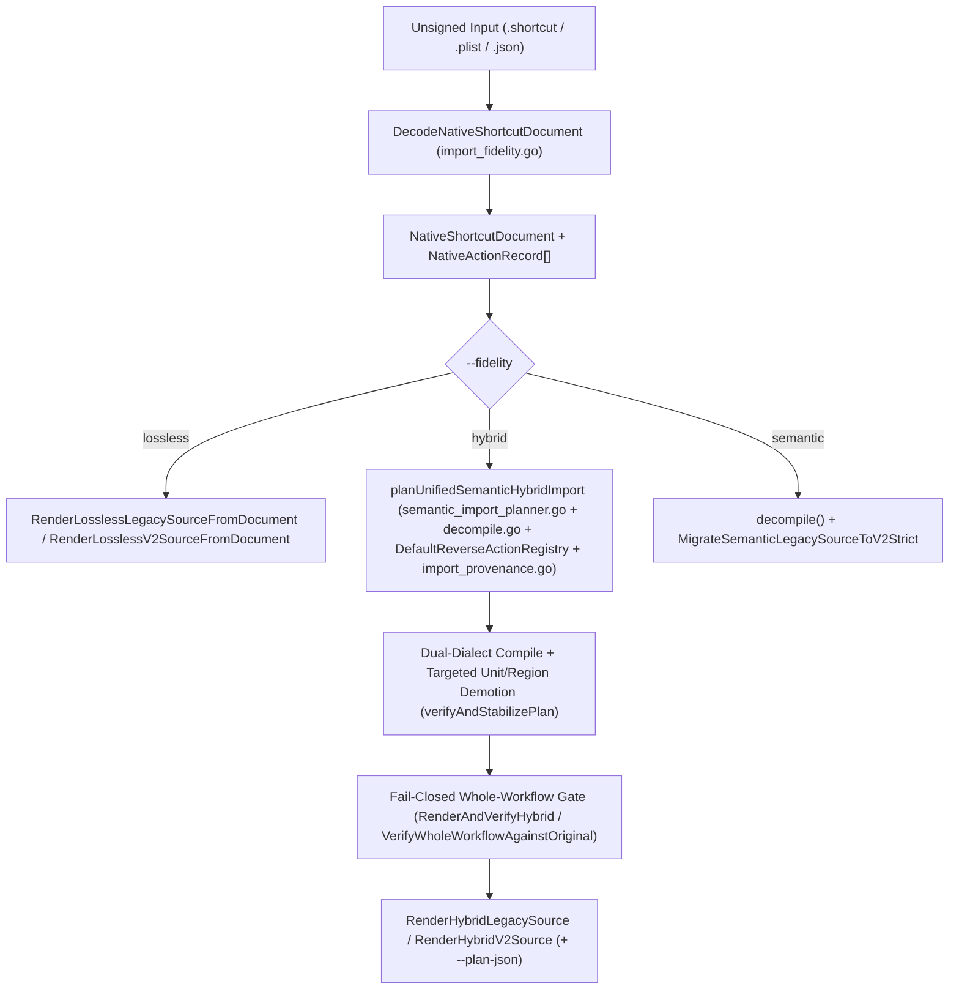

# Unified Import & Compiler Contract (P10R9 / P10R10)

**Date:** 2026-11-12  
**Status:** Active Architectural Contract (P10R10)  
**Owners:** `[איתן | Architecture]`, `[נועם | Engineering]`, `[רוני | QA]`

---

## 1. Purpose & Non-Negotiable Principles

Cherri operates as **one shared Apple Shortcuts compiler, decompiler, and action catalog engine** with two explicit surface syntax frontends (**Legacy** and **Cherri v2**).

1. **Single Source of Truth (SSoT):**
   - Built-in action definitions live in `actions/*.cherri` and `actions_std.go` (`EnsureCanonicalStandardActions()`).
   - No parallel action catalog, hand-maintained V2 registry, or duplicate plist emitter may exist.
   - `tools/language-schema` derives `internal/language/schema/generated_registry.go` directly from `cherri --actions-json`, and `tools/language-schema --verify-generated` enforces zero drift in CI.
2. **One Shared Native Document & Codec (`import_fidelity.go`):**
   - Every import path (`cherri import`, `cherri --import=...`, `ExecuteImportPipeline`, `decompileForMobileWithOptions`) decodes raw `.shortcut` / `.plist` / `.json` inputs through `DecodeNativeShortcutDocument(b []byte) (*NativeShortcutDocument, error)`.
   - `DecodeNativeShortcutDocument` enforces strict schema validation before any rendering or decompilation:
     - Rejects signed `AEA1` containers (`HYB18`).
     - Rejects trailing tokens/garbage after root JSON objects (`HYB20`).
     - Validates `root.WFWorkflowActions` is an array when present (`HYB19`).
     - Validates every `WFWorkflowActions[i]` element is a dictionary with a non-empty string `WFWorkflowActionIdentifier` and an optional dictionary `WFWorkflowActionParameters` (`HYB21`).
     - Validates control-flow block pairing (`WFControlFlowMode` 0/1/2 and `GroupingIdentifier` stack) and builds the producer/consumer `UUID` dependency graph.
3. **One Shared Backend & Action Emission (`action.go`, `language_backend_adapter.go`):**
   - Both Legacy (`shortcutgen.go` -> `makeAction`) and V2 (`lower.go` -> `CanonicalBackendSession.EmitResolvedCall`) evaluate canonical action definitions through `ActionEmissionContext` / `getActionParameters` in `action.go` and shared control-flow/token codecs in `shared_codec.go` and `shared_control.go`.
   - `EmitNativeWorkflow` in `language_emit_adapter.go` remains quarantined and unreachable from production `CompileSourceToPlist()`.
4. **Fail-Closed Mode Isolation:**
   - V2 compilation never falls back to the Legacy compiler on syntax or semantic errors (`HYB27`).
   - Semantic V2 import (`--fidelity=semantic --mode=v2`) validates migration diagnostics and V2 AST parsing via `MigrateSemanticLegacySourceToV2Strict`, failing closed on invalid output instead of silently emitting Legacy syntax (`HYB28`).

---

## 2. Unified Import Pipeline Architecture

---

## 3. Import Fidelity Modes & Guarantees

| Fidelity Mode | CLI Invocation | Wire Guarantee | Output Representation |
| :--- | :--- | :--- | :--- |
| **`lossless`** | `cherri import <file> [--fidelity=lossless] [--mode=v2\|legacy]` | **100% Exact Native Wire Parity** (`38/38` real corpus shortcuts) | Exact header (`native.workflow(..., exact: true)` / `#workflowheader`) + 1:1 raw actions (`native.action` / `rawAction`). |
| **`hybrid`** | `cherri import <file> --fidelity=hybrid [--mode=v2\|legacy] [--plan-json=<path>]` | **100% Exact Native Wire Parity** (`38/38` real corpus shortcuts, `10,871/27,652` = `39.31%` natural readable actions) | Exact provenance-carrying header (`__CherriImportProvenance` stripped at compile) + shared semantic plan rendered as Legacy/V2 calls, variables, dictionaries, and control blocks with per-unit/per-region native fallback. |
| **`semantic`** | `cherri --import=<file> [--fidelity=semantic] [--mode=v2\|legacy]` | **Best-Effort Semantic Reconstruction** | Legacy decompiler reconstruction (`#define`, `@var`, `if`/`menu`/`repeat` blocks); in `mode=v2`, strictly migrated and validated via `MigrateSemanticLegacySourceToV2Strict`. |

---

## 4. Deterministic Reverse Action Registry & Unified Semantic Hybrid Planner Contract

1. **Deterministic Reverse Lookup (`reverse_action_registry.go`) + Shared `decompile.go` Passes:**
   - `DefaultReverseActionRegistry()` indexes `EnsureCanonicalStandardActions()` by full `AppleIdentifier` with lexicographically sorted candidate lists.
   - `planUnifiedSemanticHybridImport` (`semantic_import_planner.go`) reuses `decompile.go` semantic passes (`prepareDecompileSemanticPasses`, `matchAction`, `decompAggrandizements`, `utf16OffsetToRuneIndex`, `sanitizeIdentifier`) and coordinates with `import_provenance.go` (`buildImportProvenance`, `applyImportProvenanceToCompiledActions`, `hasImportProvenanceKey`) so Legacy and V2 render from one shared semantic plan.
   - `ResolveReverseActionCandidate(rec NativeActionRecord)` and the unified planner classify every action into one of seven mutually exclusive reason codes:
     - `KNOWN_DISAMBIGUATED`: Verified natural statement, expression, variable binding, or balanced control-flow region whose Legacy and V2 compilations both reproduce the exact original plist wire structure.
     - `AMBIGUOUS_VARIANT`: Multiple canonical definitions share `AppleIdentifier` and wire parameters lack a distinguishing discriminator or tie on structural scores (`HYB06`).
     - `UNREPRESENTABLE_PARAM`: Parameter, output/aggrandizement shape, extra undocumented plist key (`HYB08`), or complex value cannot be reconstructed identically in both dialects.
     - `CONTROL_REGION`: Control-flow marker (`WFControlFlowMode` / `GroupingIdentifier`) whose enclosing control region could not be promoted atomically.
     - `UNKNOWN_NATIVE_ID`: Uncatalogued `is.workflow.actions.*` identifier (`HYB05`).
     - `THIRD_PARTY_NO_CANONICAL_DEF`: Third-party app intent outside the built-in catalog (`HYB15`).
     - `SOURCE_INVALID`: Malformed source control-flow marker (e.g. `035` index `723` `CONTROL_FLOW_ORPHAN_END`, `HYB14`).
2. **Fail-Closed Provenance & Whole-Workflow Verification (`hybrid_import.go`, `semantic_import_planner.go`, `import_provenance.go`):**
   - `__CherriImportProvenance` in `#workflowheader` / `native.workflow` seeds original action `UUID`, `CustomOutputName`, `GroupingIdentifier`, `Show-*` flags, and variable/symbol bindings during compilation and is always stripped from output plists; `VerifyWholeWorkflowAgainstOriginal` recursively rejects any compiled artifact containing `__CherriImportProvenance` (`hasImportProvenanceKey`).
   - `RenderAndVerifyHybrid` and `verifyAndStabilizePlan` enforce structural decision count equality (`len(plan.Decisions) == len(doc.Actions)`), recompile after targeted per-unit/region demotion without mutating the caller's plan on failure, select `plist.BinaryFormat` pre-marshal when `plistValueHasXMLUnsafeStringChar` detects `\x0b`/NUL (`HYB16`), and refuse to return success unless final Legacy and V2 compiled plists satisfy `plistValuesStrictlyEqual(doc.RawRoot, compiled)`.
